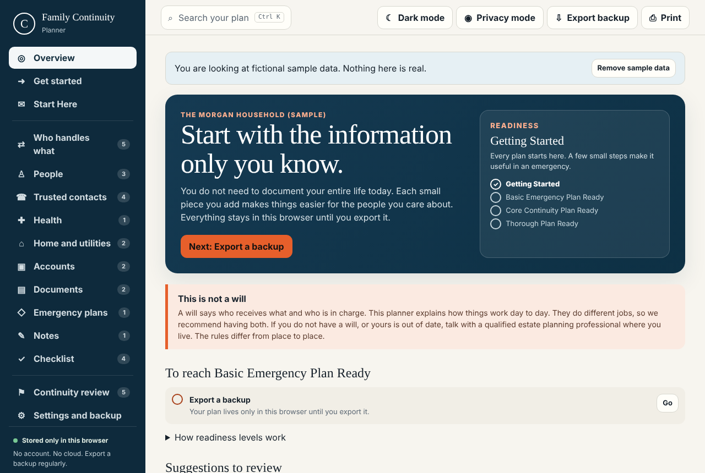
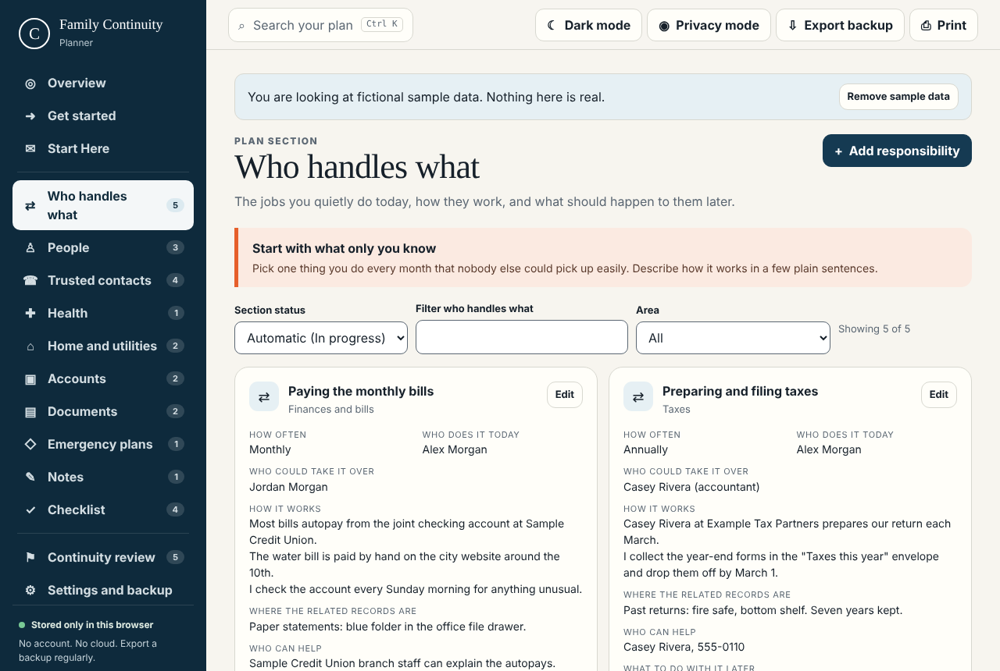
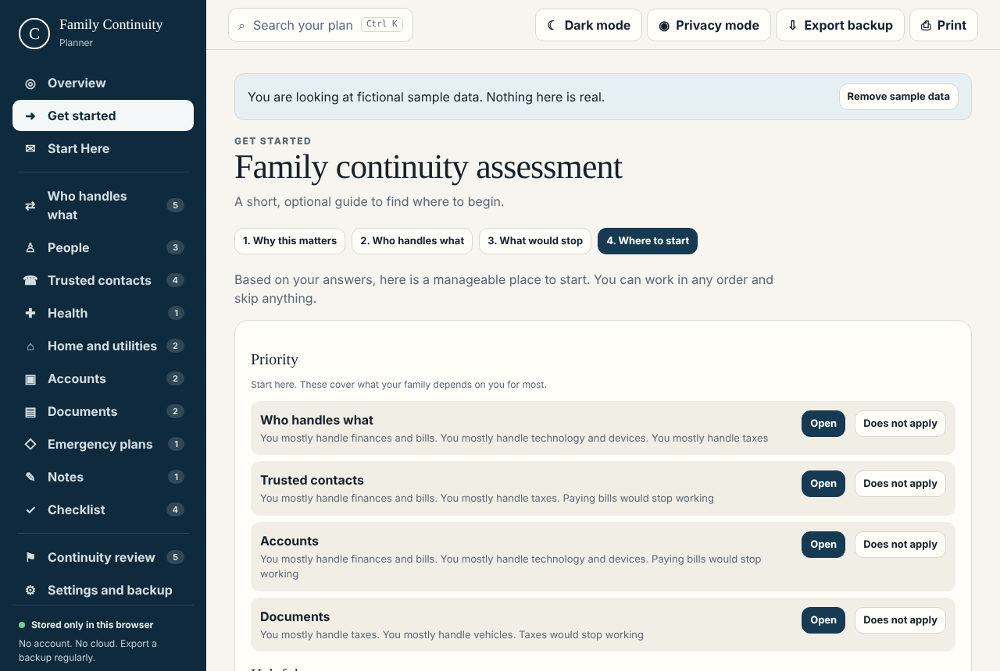
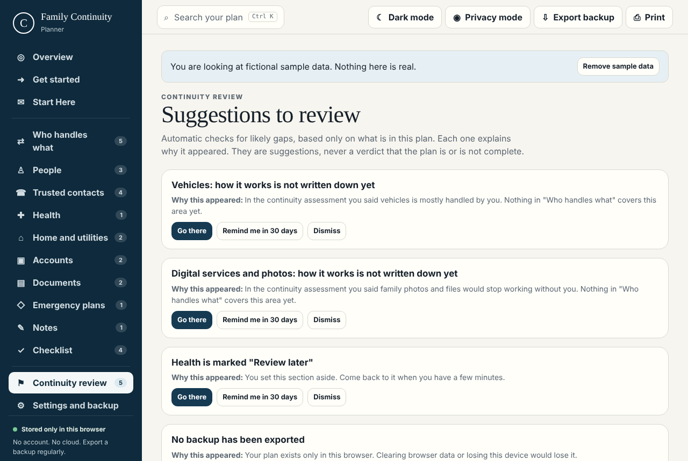
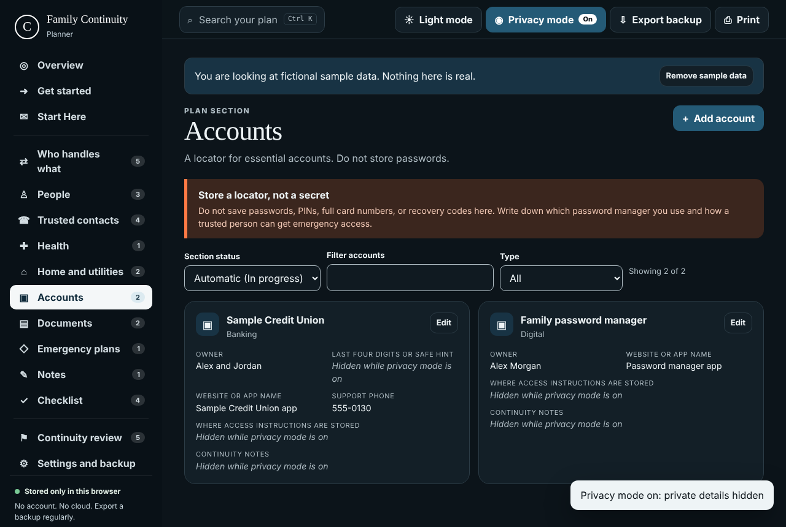

# Family Continuity Planner

**Most estate planning focuses on what you own. Family Continuity Planner focuses on what you know.**

It helps you document the practical knowledge your family may need if you are no longer available to help: household responsibilities, trusted contacts, technology, finances, maintenance, important records, and the everyday information that normally lives only in your head.

It is a single file that runs in your web browser. No account, no subscription, no cloud, no internet connection. Your plan never leaves your computer unless you export it.

**Two free ways to use it:**

- **Online:** open [graybound.github.io/family-continuity-planner](https://graybound.github.io/family-continuity-planner/). Nothing to install. Your plan is saved only in that browser on that device and is never sent to GitHub or anyone else.
- **Download:** get the latest zip from [Releases](https://github.com/Graybound/family-continuity-planner/releases/latest) and open it from your own computer or a USB drive. This is the most private option and keeps working even without internet.



## Why it exists

When someone who quietly runs a household dies, becomes seriously ill, or simply cannot help for a while, the people left behind often face two problems at once: grief or worry, and a pile of unknowns. Which bills are on autopay? Who does the taxes? Where is the water shutoff? Who fixes the furnace? How do we get into the family photos?

A will says who gets what. This planner helps write down **how things work**, so the family can keep functioning.

> **This is not a will.** Family Continuity Planner works alongside a will; it does not replace one. If you do not have a will, or yours is out of date, we recommend having one prepared with a qualified estate planning professional where you live. Laws differ from place to place.

## Who it is for

Anyone who wants to make things easier for the people they would leave behind: single people, couples, parents, people without children, caregivers, adult children helping parents, blended families, pet owners, homeowners and renters, small business owners, and anyone whose technology or paperwork only they understand. It does not assume a family structure, country, religion, or financial situation.

## What it does

- **Who handles what.** Describe the jobs you do today, how they work, who could take them over, and whether they should be kept, simplified, transferred, canceled, or ignored later.
- **Guided start.** A short, optional assessment finds where your family depends on you most and recommends a manageable place to begin, grouped into Priority, Helpful, and Optional.
- **Life-area sections.** People, trusted contacts, health, home and utilities, accounts (as a locator, never passwords), documents, emergency plans, and notes.
- **Start Here.** A calm introduction your family reads first, with a default you can keep, edit, or replace, plus optional personal messages for specific people.
- **Readiness levels instead of a misleading percentage.** Getting Started, Basic Emergency Plan Ready, Core Continuity Plan Ready, Thorough Plan Ready. Each level lists exactly what it needs.
- **Continuity review.** Plain, explainable suggestions about likely gaps ("You said taxes are mostly handled by you, but nothing describes how"), each with a reason, a link, and options to dismiss or snooze.
- **Checklist** for first-24-hours actions, information to gather, people to brief, and quarterly upkeep.
- **Printed packet** on US Letter paper: cover page, Start Here, immediate actions, trusted contacts, then each section. Private details are withheld unless you choose to include them.
- **Backup and restore** to a documented JSON file, with a preview and confirmation before anything is replaced. Backups from the original version of the app still restore.
- **Privacy mode** hides private details on screen (useful when someone is looking over your shoulder).
- **Search** across everything (Ctrl+K or Cmd+K), light and dark themes, full keyboard use, and phone-sized screens.

| | |
|---|---|
|  |  |
|  |  |

A sample printed packet made from the fictional sample data is in [docs/screenshots/sample-packet.pdf](docs/screenshots/sample-packet.pdf).

## Project status

Version 0.2.0. The core planner, backups, printing, guided start, readiness levels, and continuity review are implemented and tested. Audience-specific packets (executor, caregiver, technology helper), review reminders, and encrypted backups are planned but **not** built yet. See [ROADMAP.md](ROADMAP.md).

## Privacy in one paragraph

Everything you type is stored in your browser's local storage on your computer and nowhere else. The app makes no network requests at all; a strict security policy built into the file blocks them. **Nothing is encrypted**, so anyone who can use your computer account and browser can read the plan, and anyone who gets your backup file or a printout can read that. Details, risks, and advice are in [PRIVACY.md](PRIVACY.md) and [SECURITY.md](SECURITY.md).

## Quick start

Want to try it first? Open the [online version](https://graybound.github.io/family-continuity-planner/) and load the sample data. To install it on your own computer:

1. Go to the [Releases page](https://github.com/Graybound/family-continuity-planner/releases/latest) and download `Family-Continuity-Planner-vX.Y.Z.zip`.
2. Extract it somewhere you will remember: your Documents folder, a USB drive, or a private network drive.
3. Double-click `Family-Continuity-Planner.html`. It opens in your browser.
4. Optional: go to **Settings and backup**, then **Load sample data**, to look around with a fictional family. Click **Remove sample data** when you are done.
5. Start with **Get started**, or go straight to **Who handles what** and write down one thing only you know how to do.
6. Click **Export backup** when you finish a session.

You do not need Git, Node.js, or any technical tools. A single `Family-Continuity-Planner-vX.Y.Z.html` file is also attached to each release if you prefer one file without the zip.

### Using it from a USB drive, external drive, or NAS

Copy the extracted folder there and open the HTML file from it. Keep two things in mind:

- Your plan is saved **in the browser on the computer you use**, not on the drive. Opening the file on another computer shows an empty plan. To move your plan, export a backup and restore it on the other computer.
- Always open the file from the same place in the same browser. Some browsers tie saved data to the file's location. If the plan looks empty after you move the file, nothing is lost: open it from the original location or restore your latest backup.

## Backing up and restoring

- **Export:** the **Export backup** button (top bar, or Settings and backup) downloads `family-continuity-backup-YYYY-MM-DD.json`. Do this after any significant change. Readiness levels and the review page remind you when the last backup is old.
- **Store it privately.** The file is plain text and not encrypted. Keep it in a place only you and trusted people can reach, and tell one trusted person where it is. An encrypted USB drive or an encrypted folder is a good choice.
- **Restore:** Settings and backup, then **Restore from file**. You will see what the file contains, any problems that were fixed, and how your current plan will be affected. You can export your current plan first. Nothing changes until you confirm.
- **Old backups** made by the original single-file version (the `version: 1` format) restore and are upgraded automatically. Details: [docs/backup-format.md](docs/backup-format.md).

## Printing

Click **Print**. Choose whether to include private details (off by default), then use your browser's print window to print or save as PDF. The packet is designed to make sense without the app: it starts with a reassuring Start Here page, then immediate actions and trusted contacts, and shows the date printed, the last review date, and a reminder to check that information is current. Store printouts securely and shred old copies.

## Frequently asked questions

**Is this a will?** No. It is an organizational and knowledge-transfer tool, and a will or other legal documents take priority over anything in it. We recommend having both: a will for who receives what and who is in charge, and this planner for how everything actually works. A qualified professional where you live can help with the will, and you can record where it is kept in the Documents section.

**Should I store passwords in it?** No. Record which password manager you use, how a trusted person can get emergency access, and where recovery documents are kept. The review page flags text that looks like a password or card number.

**Can I use it on my phone?** Yes, it works on phone-sized screens. Your phone's browser keeps its own separate copy, so pick one main device and use backups to move between them.

**What if this project stops being maintained?** The planner keeps working. It is one HTML file with no server and no outside dependencies, and backups are plain, documented JSON you can read in any text editor.

**Can my family read it if I am not there?** Yes, through the printed packet, a saved PDF, or by opening the planner on your computer. Tell a trusted person where the printout and backup are.

**Is there an online version?** Yes: [graybound.github.io/family-continuity-planner](https://graybound.github.io/family-continuity-planner/). It is the same file as the download, served by GitHub Pages. Your plan stays in your browser either way. The download is a little more private and does not depend on GitHub staying online; see [docs/github-pages.md](docs/github-pages.md) for the difference.

**What if I start online and later switch to the download (or the other way)?** Export a backup from one and restore it in the other. They do not share saved data.

## Limitations

- Data lives in one browser on one device. There is no sync, by design.
- Nothing is encrypted, at rest or in backups.
- Clearing browser data for the file or site erases the plan. Keep backups.
- In automated tests, Chrome occasionally (about 2 to 7 percent of tries, on a heavily loaded test machine) failed to keep a save made just before the page was reloaded, but only when the app was opened as a file from disk, never over the web. This has not been confirmed on an ordinary desktop yet and is being investigated. Until then: pause a moment after saving before closing or reloading, and export backups regularly.
- Readiness levels and review suggestions are simple, documented rules. They cannot know what is missing from your life; they never mean a plan is "complete."
- Printing is designed for US Letter. A4 printing works but is not specifically tuned.
- Tested in Chromium-based browsers. Firefox and Safari are expected to work but are not yet covered by automated tests.

## Roadmap summary

Next up: audience-specific printed packets, review reminders and guided maintenance, more life areas (pets, vehicles, children, digital legacy), A4 print layout, and cross-browser automated tests. Encrypted backups are being considered carefully because a lost passphrase would lock a family out. Full plan: [ROADMAP.md](ROADMAP.md).

---

## For developers

Requirements: Node.js 20 or newer (22 recommended) and npm.

```sh
git clone https://github.com/Graybound/family-continuity-planner.git
cd family-continuity-planner
npm ci
npm run dev            # development server at http://localhost:5173
npm test               # unit tests (Vitest)
npm run build          # dist/index.html, the single-file app with its CSP
npx playwright install chromium
npm run test:e2e       # browser tests against dist/index.html over file://
npm run check          # everything CI runs: lint, types, unit, build, browser tests, privacy scan
npm run release        # release/ files: .html, .zip, SHA256SUMS.txt
```

Architecture, data schema, and design decisions: [ARCHITECTURE.md](ARCHITECTURE.md). The recovered original app and what changed: [EXISTING_APPLICATION_AUDIT.md](EXISTING_APPLICATION_AUDIT.md) and [legacy/](legacy/). Product vision and scope: [PROJECT_SPEC.md](PROJECT_SPEC.md). Releasing: [docs/releasing.md](docs/releasing.md).

### Contributing

Contributions are welcome. Please read [CONTRIBUTING.md](CONTRIBUTING.md) and the [Code of Conduct](CODE_OF_CONDUCT.md). Never include real personal information in issues, pull requests, tests, or screenshots.

### Security

Please report vulnerabilities privately as described in [SECURITY.md](SECURITY.md), not in public issues.

## License

The software is released under the [MIT License](LICENSE). The license covers the code and documentation in this repository; it does not cover the information you put into your own plan, which is yours.

## Disclaimer

Family Continuity Planner is an organizational and knowledge-transfer tool. It is not a will and does not replace estate planning. We recommend using it alongside a will and any other estate documents that fit your situation, prepared with a qualified professional where you live. It is not legal, financial, or medical advice, and it does not replace advice from an attorney, accountant, financial professional, healthcare professional, or other qualified professional. It is provided as is, without warranty.
