# Flow review: can someone new follow it start to finish?

Reviewed 2026-11-26 against the built single file, on top of the UI review branch (PR #18). Two personas, each with fresh browser storage, at 1280x860 and 390x844:

- **Creator, first open.** Empty plan, no idea what the app is.
- **Reader, plan already filled in.** The built-in sample plan, opened by someone who did not write it.

The bar is the wife test: not technical, possibly grieving, nobody to ask. Logged: every spot where the next step is unclear, two things compete for attention, two labels sound alike, or a question needs knowledge the person may not have.

"Fixed" means fixed in the PR that adds this file. "Issue" means it changes navigation structure, the backup schema, or the readiness rules, so it waits for a decision. "Elsewhere" means another open spec or thread already owns it.

## Creator, first open

| # | What happens | Kind | Status |
|---|---|---|---|
| C1 | The overview hero has three buttons: "Next: Name at least one trusted contact", "Take the continuity assessment", "Export backup". Exporting an empty plan is not a sensible first move, and the assessment competes with the next step for the first click. | Competing actions | Fixed. One button: the next step. The questions are a quiet link under it. Export stays in the top bar. |
| C2 | A trusted contact is asked for three times on one screen: the Next button, the first "To reach" item, and a "No trusted contacts yet" suggestion. A fourth place, "First person to contact" in Settings, asks for the same person in a different form. | Duplicate | Fixed for the overview (a suggestion is hidden while the same thing is already a next step). The Settings field is a schema question: issue. |
| C3 | "Get started" and "Start Here" sit next to each other. One is a questionnaire for the creator, the other is the letter the family reads. | Labels sound alike | Fixed. "Get started" is now "Planning questions", moved down with the creator tools. |
| C4 | Inside the questions, step 2 is called "Who handles what", which is also the name of a section page. | Labels sound alike | Fixed. The step is now "Who does what today". |
| C5 | The sidebar is 13 flat items. Its section order (Who handles what, People, Trusted contacts...) disagrees with the Next button (Trusted contacts, Emergency plans, Documents...). Following Next makes you jump around the list. | No sense of order | Fixed for order: the sidebar now lists sections in the order the Next button asks for them, and a unit test keeps them in step. Group headings ("Do these first" / "Add when you can") change navigation structure: issue. |
| C6 | "This is not a will" shows on the overview and again on the first questions step, word for word. It is also in the Documents callout and in print. | Duplicate | Fixed. Removed from the overview. The creator still meets it in the questions, in Documents (which the first level sends them to), and in print. |
| C7 | Jargon: "continuity assessment", "Continuity review", "Readiness", "Your continuity plan", "Basic Emergency Plan Ready", "Core Continuity Plan Ready". | Jargon | Fixed. "Planning questions", "Suggestions", "How ready your plan is", "Your plan", and levels named Just started, Ready for an emergency, Covers everyday life, Thorough and up to date. Internal ids are unchanged. |
| C8 | On an empty plan, "Your plan at a glance" is nine cards that each say "0 entries, Not started". | Noise | Fixed. It appears once the plan has something in it. |
| C9 | The 14 "who does it today" questions name areas ("Household operations", "Family coordination", "Important records") without saying what is in them. | Needs knowledge | Fixed. Each area has a line of examples, read out by screen readers with the question. |
| C10 | Recommendations and Suggestions say "Open" or "Go there" without naming the page. | Unclear next step | Fixed. Buttons name the page ("Open Trusted contacts", "Add to Who handles what"). |
| C11 | "Seasonal jobs" in "What would stop working" is vague. | Needs knowledge | Fixed: "Seasonal jobs, like clearing gutters or the furnace check". |
| C12 | The checklist dialog says "Keep the next action concrete and assignable." | Jargon | Fixed: "One small, specific thing to do, such as ...". |
| C13 | There is no welcome. A first open lands on the creator's overview whether you are writing a plan or were handed one. | Unclear next step | Issue (welcome screen and guided first steps). This is the centerpiece of the target flow below. |
| C14 | Start Here is never part of the suggested path. A creator can reach every level without writing a word of their own in the letter. | Missing step | Decision (readiness rule change). |
| C15 | "Save details" in Settings and "Save introduction" in Start Here lose typing silently if you navigate away. | Data loss | Elsewhere (PR #18, item 9). |

## Reader, filled plan

| # | What happens | Kind | Status |
|---|---|---|---|
| R1 | The reader lands on the creator's overview: "Start with the information only you know", readiness levels, Next buttons. Nothing says "start reading here". | Wrong audience | Elsewhere (reader view, PR #13) plus the welcome screen issue. |
| R2 | A complete-looking sample plan shows "Just started" (was "Getting Started") because no backup was exported. To a reader that reads as "this plan is unfinished, don't trust it". | Wrong audience | Elsewhere (PR #13 hides levels from readers). |
| R3 | The default Start Here text says to start with the "Immediate actions" section. No page has that name; the closest is "Emergency plans". "Immediate actions" exists only as a print heading. | Labels disagree | Elsewhere (Start Here rewrite thread, told). Naming decision below. |
| R4 | Start Here opens with "Which introduction should the plan use?" radio buttons before the letter. | Wrong audience | Elsewhere (PR #13). |
| R5 | The sidebar shows "Suggestions 5" with a count badge. A reader may think something is wrong. | Wrong audience | Elsewhere (PR #13 hides it). |
| R6 | On a new device there is no plan at all, and nothing tells the reader how to open the backup they were given. | Dead end | Issue (welcome screen) with PR #13 slice 2. |

## Questions and field prompts

Field labels and help text for every section are already covered field by field in the content review spec (PR #16, recommendation 5). This review does not repeat them. What it adds is the part that spec does not cover:

- **Planning questions.** Fixed above (C4, C9, C11). One idea per question already holds. Every question is optional and says so. Nothing assumes legal knowledge after the area hints.
- **Settings, Plan details.** "Home city or region" is shown nowhere (PR #16, recommendation 14). "First person to contact" overlaps Trusted contacts (issue, C2).
- **Checklist dialog.** Fixed (C12).
- **Personal message dialog.** Plain, has an example, required fields say so. No change.
- **Emergency plans field "Steps, one per line".** Fine as a label. PR #16 adds help text.

## Target flow

One obvious next step at all times. No wizard framework and no new dependencies: the existing pages do the work.

1. **First open, no plan in storage: a welcome screen** asks one question, "Are you making a plan, or opening a plan someone left for you?"
   - Making a plan: guided first steps on the existing pages (trusted contact, one emergency step, one document location, export a backup), each with a step banner and Next / Skip. Also "I already have a backup" for a creator on a new device.
   - Opening a plan: straight to opening the backup file, then reader view at Start Here. Never the creator flow.
   - The screen also says that if you used the planner on this device before, the browser may have cleared it, and to open your latest backup.
2. **Plan exists: open as today**, or in reader view on a device set up for reading (PR #13).
3. **Overview: one button, "Next"**, which walks down the sidebar in order. Done in this PR.
4. **Sidebar in two groups** ("Do these first": Start Here, Trusted contacts, Emergency plans, Documents; "Add when you can": the rest), then the creator tools. Order done in this PR; headings in the issue.

The welcome screen and guided steps are sketched in the issue for a decision before anything is built.

## Screenshots

Sample data in the reader shots is fictional.

| Screen | Before | After |
|---|---|---|
| Creator, first open | 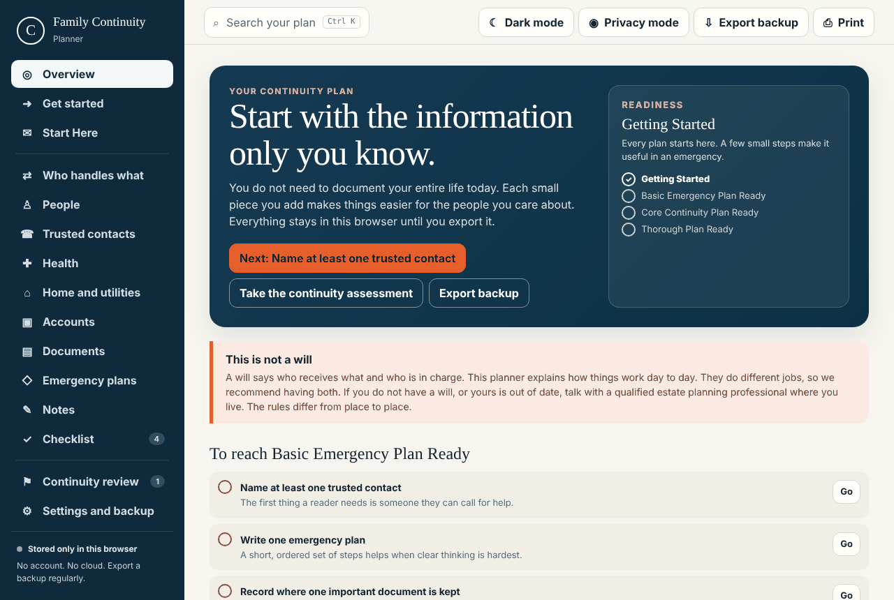 | 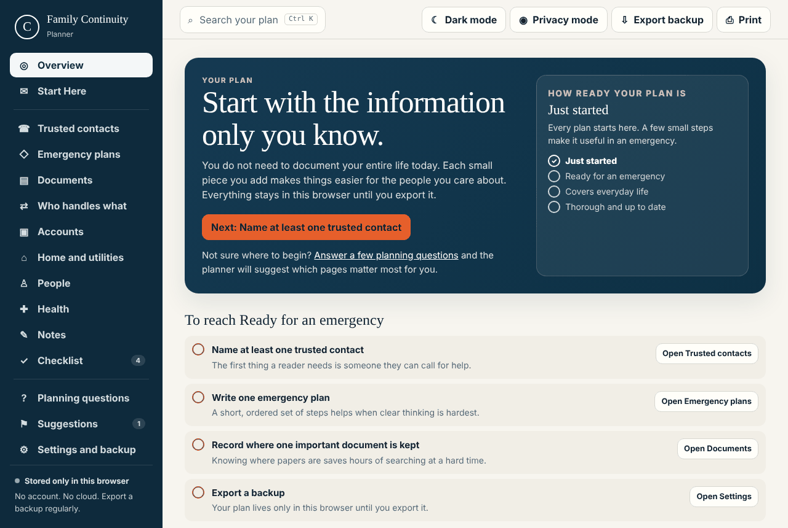 |
| Creator, first open, phone | 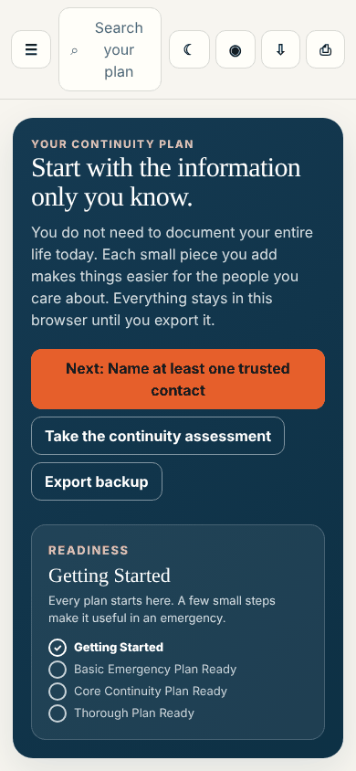 | 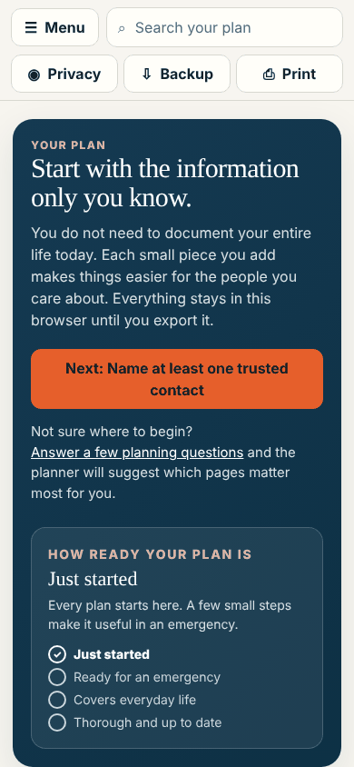 |
| Planning questions, step 2 | 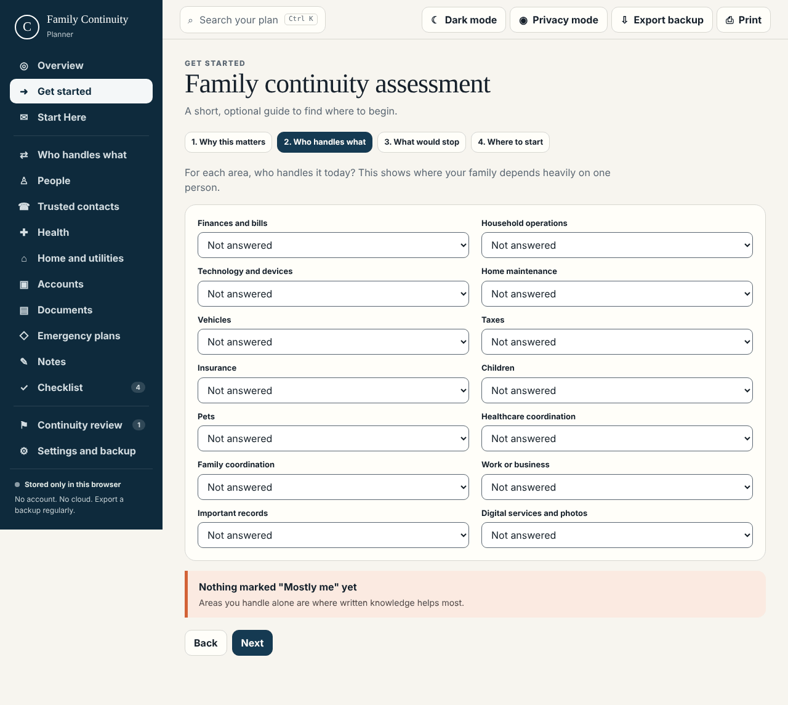 | 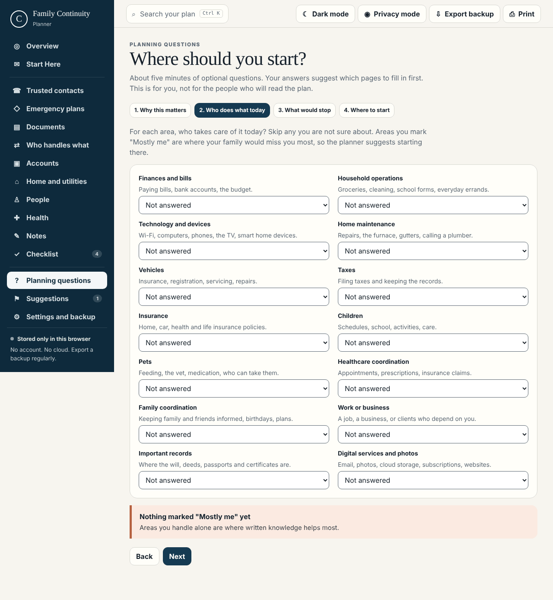 |
| Suggestions | 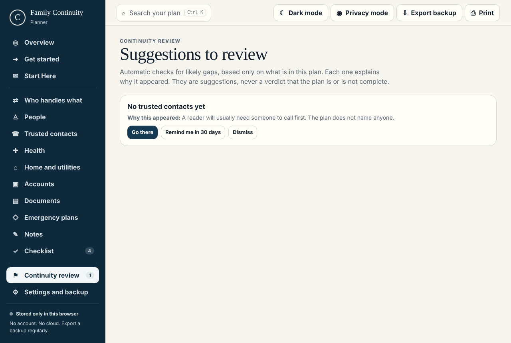 | 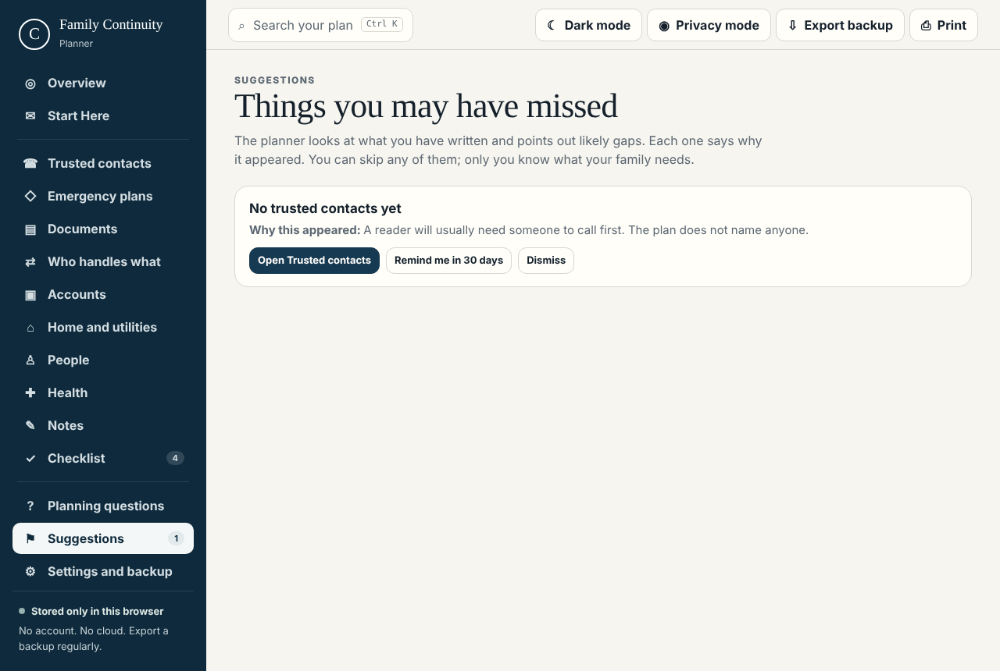 |
| Reader, sample plan overview | 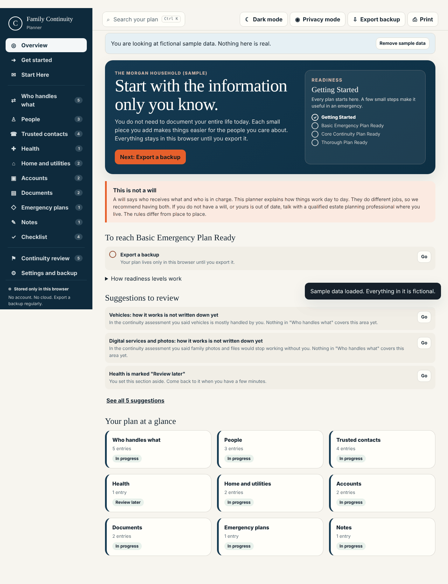 | 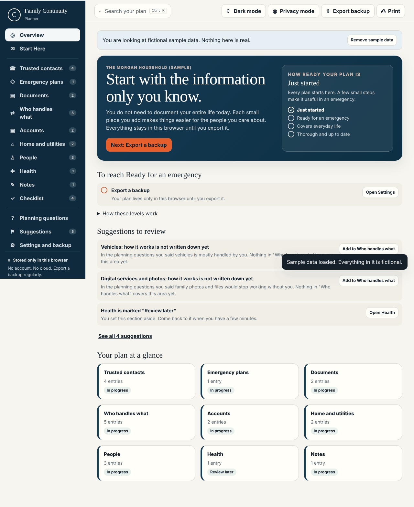 |
| Reader, Start Here | 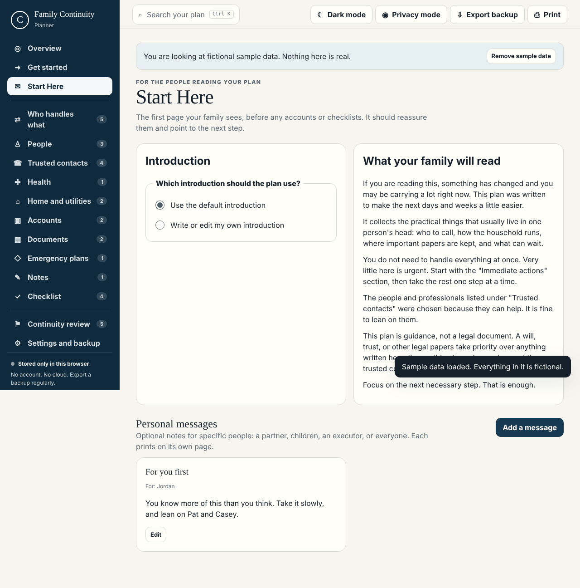 | Unchanged here (PR #13) |
