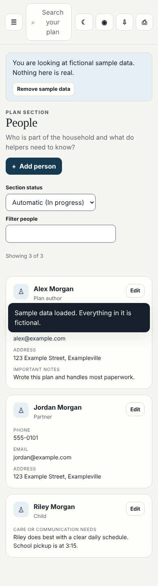
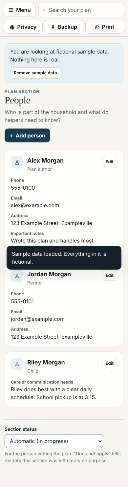
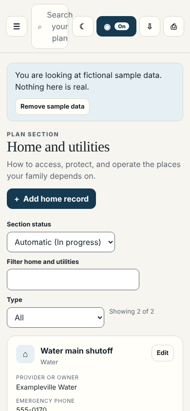
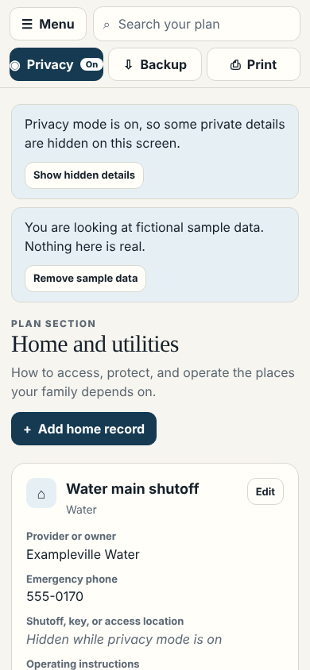
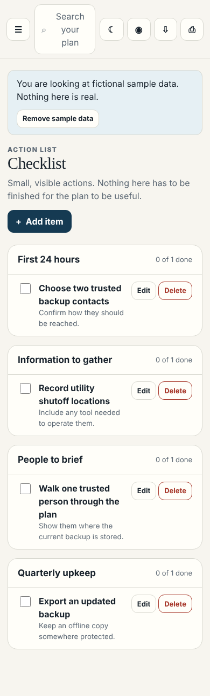
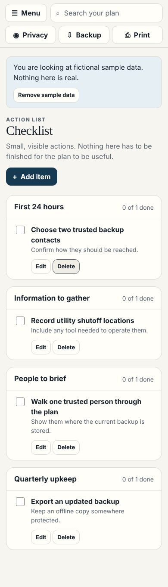

# UI review: the stressed reader

Reviewed 2026-11-26 against the built single file (`dist/index.html`, v0.2.0) at 1280x860 and 390x844, light and dark, empty plan and sample plan. Every screen in the nav, the edit dialog, search, and the phone menu.

The lens is the reader, not the creator: someone who is not technical, is upset, and is probably on a phone. Would they understand the screen and act on it alone?

Ranking is by how badly the problem could hurt that reader, then by effort. "Fixed" means fixed in the PR that adds this file. "Open" items need a decision, another thread, or a change outside `src/ui` and `src/styles`.

## Summary

| # | Problem | Severity | Status |
|---|---------|----------|--------|
| 1 | No reader entry point; the overview talks to the creator | High | Open (reader-mode spec) |
| 2 | Phone top bar is four unlabeled symbols and a squashed search box | High | Fixed |
| 3 | Privacy mode can hide details with no visible way back | High | Fixed |
| 4 | "Get started" and "Start Here" sit next to each other and mean different things | High | Open (needs test change) |
| 5 | Record cards bury the answer under tiny uppercase labels | Medium | Fixed (styling); Open (field priority) |
| 6 | Creator controls sit above the content on every section page | Medium | Fixed |
| 7 | "Go" buttons do not say where they go | Medium | Fixed |
| 8 | Help and secondary text is 12 to 13px | Medium | Fixed |
| 9 | Unsaved edits in Plan details and Start Here are lost silently | Medium | Open |
| 10 | Checklist rows on a phone squeeze the task into a narrow column next to a red Delete | Medium | Fixed |
| 11 | The "not a will" notice outranks the next step on the overview | Low | Fixed |
| 12 | Unstyled link in Settings; dark sidebar blends into the page | Low | Fixed |
| 13 | Empty overview repeats "0 entries / Not started" nine times | Low | Open |
| 14 | Hero headline is very large on desktop | Low | Open |

## 1. No reader entry point (High, Open)

**What happens.** Whoever opens the file lands on the Overview, whose headline is "Start with the information only you know." Everything on it (readiness, "To reach Basic Emergency Plan Ready", Export backup) is for the person writing the plan. A reader has to guess that "Start Here" in the sidebar is meant for them, and Start Here itself opens with radio buttons for which introduction to use.

**Why it matters.** This is the first ten seconds on the worst day. The reader is shown a to-do list addressed to someone else.

**Fix.** This is the job of reader mode, which has its own spec. Not built here on purpose. Requirements from this review for that spec: the first screen a reader sees is the Start Here text and the first contact, with no readiness, no edit buttons, and no backup prompts; it works at 390px wide without opening the menu.

## 2. Phone top bar is unreadable (High, Fixed)

**What happens.** Below 980px every top-bar button collapses to a glyph: ☾ ◉ ⇩ ⎙. On a phone the search box is squeezed to about 110px and "Search your plan" wraps onto three lines. Nobody non-technical knows that ◉ means "privacy mode" or ⇩ means "export backup".

**Fix.** On phones the search box gets its own full-width row with one-line text. Action buttons keep short visible labels ("Privacy", "Backup", "Print"). The theme toggle is hidden on phones; it is also in Settings. Full names stay as the accessible names, so screen readers and the existing tests are unchanged.

Files: `src/ui/app.ts` (`renderTopbar`), `src/styles/app.css` (media queries).

## 3. Privacy mode can strand the reader (High, Fixed)

**What happens.** With "Start in privacy mode" on, or after one stray tap on ◉, every private field shows "Hidden while privacy mode is on". The only sign is a pressed button in the top bar, which on a phone is an unlabeled circle. A reader could reasonably believe the information is gone.

**Fix.** While privacy mode is on, a banner at the top of every screen says so in plain words and has one button, "Show hidden details", that turns it off.

Files: `src/ui/app.ts` (`renderBanners`).

## 4. "Get started" next to "Start Here" (High, Open)

**What happens.** The first two nav items after Overview are "Get started" (the creator's assessment) and "Start Here" (the page for the family). A reader told "start here" will very likely tap "Get started" and land in a questionnaire about who handles taxes.

**Fix.** Rename the nav item and page title to "Planning questions" (or "Where to begin" if we want it softer). Not done in this PR because the e2e tests navigate by the label "Get started" (`tests/e2e/core.spec.ts`, `tests/e2e/backup-print-a11y.spec.ts`) and this thread does not own tests. Needs one PR that changes `navItems()` in `src/ui/app.ts`, `viewHead` in `src/ui/views/getStarted.ts`, and the test labels together.

## 5. Record cards bury the answer (Medium, Fixed for styling, Open for priority)

**What happens.** Field labels are 11px, uppercase, letter-spaced, muted. Values are 14px. Every field has the same weight, so on an Accounts card "Where access instructions are stored" (the one thing the reader came for) looks the same as "Website or app name".

**Fix (done).** Labels are 13px sentence case; values are 16px; card titles are larger. Scanning a card for a label now works.

**Fix (open).** Add an optional `primary: true` flag on `FieldDef` in `src/core/sections.ts` so a section can mark its most important field (Accounts: access instructions; Documents: location; Home: shutoff location). The card would show that field first, full width, with a stronger label. This touches `src/core`, so it belongs with the content review or a small follow-up.

## 6. Creator controls above the content (Medium, Fixed)

**What happens.** Every section page shows "Section status", a filter box, and a type filter before the first record. On a phone that is a full screen of controls before any information, and "Section status: Automatic (In progress)" means nothing to a reader.

**Fix.** Records come first. The filter only appears once a section has more than five entries, where it starts to help. "Section status" moves to the end of the page with a one-line explanation.

Files: `src/ui/views/section.ts`.

## 7. Vague "Go" buttons (Medium, Fixed)

**What happens.** The overview lists next steps and suggestions, each with a button labeled "Go". It does not say what will happen (open a form, change pages, download a file).

**Fix.** Each button names where it leads: "Open Trusted contacts", "Open Settings", or "Add to Who handles what" when it opens a pre-filled form. Accessible names still include the full step. The Continuity review page keeps "Go there" for now because its tests use that label.

Files: `src/ui/views/dashboard.ts`.

## 8. Small text (Medium, Fixed)

**What happens.** Help text is 12px, requirement and suggestion explanations are 13px, record labels 11px. Small grey text is the first thing to become unreadable for tired eyes or on a phone held at arm's length.

**Fix.** Help and secondary text is at least 14px; record labels 13px. No text in the app is below 12px except badge counts.

Files: `src/styles/app.css`.

## 9. Unsaved edits are lost silently (Medium, Open)

**What happens.** In Settings, Plan details only save when you press "Save details". In Start Here, a custom introduction only saves on "Save introduction". Everywhere else in the app changes save as you make them. Typing a trusted contact and then tapping another nav item throws it away with no warning.

**Fix.** Save these fields on `change` like the rest of the app. The catch: `mutate()` re-renders the whole view, which moves focus when the change fires on blur. The right fix is a save path that persists without a re-render (or a re-render that preserves the element that is gaining focus). That needs a small change to `src/ui/store.ts` plus a focus test, so it is left for a dedicated PR rather than rushed here. Interim option: warn on navigation when a form is dirty.

## 10. Checklist rows on a phone (Medium, Fixed)

**What happens.** At 390px each row is checkbox, task, then Edit and a red-bordered Delete side by side. The task text wraps into a narrow column, and four red buttons in a list read as alarming.

**Fix.** On phones the Edit and Delete buttons move under the task text. In the list, Delete is a plain small button; the confirmation dialog still uses the red danger style.

Files: `src/ui/views/checklist.ts`, `src/styles/app.css`.

## 11. "Not a will" notice outranks the next step (Low, Fixed)

**What happens.** On the overview the will notice sits directly under the hero as a full-width orange callout, the same style used for warnings. Every visit, the actual next steps start below the fold.

**Fix.** The notice moves below the next steps and suggestions and uses the neutral info style. It is still on the overview, in Get started, in Documents, and in print.

Files: `src/ui/views/dashboard.ts`, `src/styles/app.css`.

## 12. Unstyled link and dark sidebar (Low, Fixed)

**What happens.** The "GitHub" link in Settings uses the browser default blue, which is hard to read on the dark surface. In dark mode the sidebar (#091117) is almost the page color (#0c141a) with no edge.

**Fix.** Links use a theme token with enough contrast in both themes. The sidebar gets a right border in dark mode.

## 13. Empty overview repeats "0 entries" (Low, Open)

Nine identical cards saying "0 entries / Not started" on a new plan are noise. Suggest hiding "Your plan at a glance" until at least one section has an entry, or showing a single line instead. Small, but it changes what the empty-state test sees, so left for a follow-up.

## 14. Large hero headline (Low, Open)

The overview headline is up to 50px serif and takes two lines on desktop. It looks good, but it pushes the first action down. Worth revisiting with reader mode, since the overview may stop being the first screen.

## Tests

`tests/e2e/ui-review.spec.ts` covers fixes 2, 3, 6, 7, 8 and 11 and fails on the build before them. It is a new file so it does not collide with other work in `tests/`.

## Screenshots

Before and after pairs are in `docs/ui-review/` (1x, sample data).

| Screen | Before | After |
|---|---|---|
| Phone, People |  |  |
| Phone, privacy mode on |  |  |
| Phone, Checklist |  |  |

## What was checked and is fine

- Focus is always visible (3px orange outline) in both themes, including on the dark sidebar and primary buttons.
- Dialogs trap focus, close on Escape, and return focus to the opener.
- The phone menu is not reachable by keyboard while closed.
- Required fields say "(required)" in words, not only with a star.
- Delete actions always confirm.
- No horizontal scroll at 390px.
